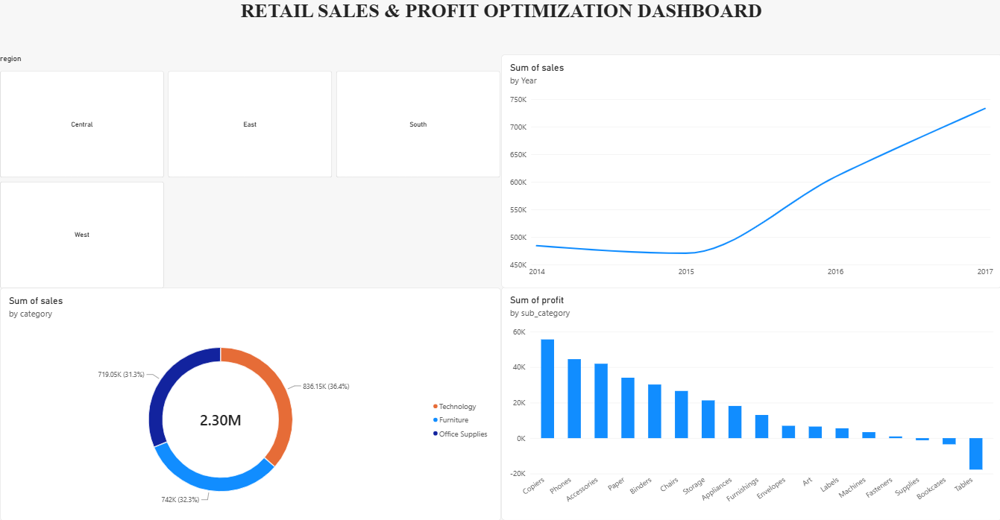

# Retail Sales & Profit Optimization (SQL + Power BI)

## 📌 Project Overview
An end-to-end data analysis project analyzing 9,994 retail orders to identify revenue drivers, regional sales trends, and profit-leaking product categories using **PostgreSQL** and **Power BI**.

## 🛠️ Tools & Technologies Used
* **Database & Data Cleaning:** PostgreSQL (pgAdmin 4)
* **SQL Analysis:** Aggregations, CTEs, Window Functions (`SUM() OVER()`), ABC Inventory Classification
* **Data Visualization:** Microsoft Power BI Desktop (Interactive Slicers, KPI Tracking, Trend Analysis)

## 🔍 Key Business Insights
* **Overall Performance:** Generated **$2.30M** in total sales with a **12.47%** overall profit margin.
* **Profit Killers Identified:** While **Furniture (Tables & Bookcases)** generated strong sales volume ($321K+ combined), heavy discounting (**21%–26% average discount**) resulted in over **$21,198 in net losses**.
* **Top Profit Drivers:** **Technology** sub-categories—especially **Copiers ($55,618 profit)**, **Phones**, and **Accessories**—delivered the highest margins with controlled discount rates.

## 💡 Business Recommendations
1. **Cap Discounts on Furniture:** Limit maximum discounts on *Tables* and *Bookcases* to **15%** to eliminate negative margins.
2. **Focus Marketing on High-Margin Tech:** Reallocate promotional budget toward *Copiers* and *Accessories* in high-performing regions.

## 📂 Repository Files
* `retail_analysis.sql` – Complete SQL script for data validation, KPI calculation, and ABC product classification.
* `RETAIL_SALES_DASHBOARD.pbix` – Interactive Power BI report file.
* `dashboard.png` – High-resolution preview of the executive dashboard.
* `Superstore.csv` – Raw dataset (9,994 records).
*
